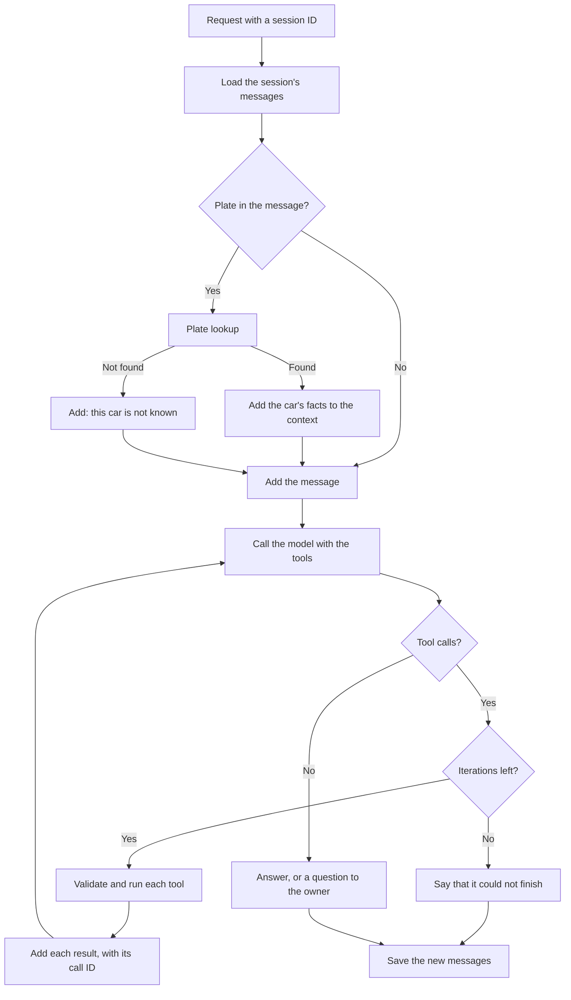

# Week 3: the agent's tools and orchestration

The homework: identify the tools of the use case, sketch the orchestration, connect and test the tools, including Genie through MCP, and keep the conversation in Lakebase.

| # | Homework | Status |
|---|---|---|
| 01 | Identify the tools: inputs, outputs, identity, local function or MCP | Design: see below |
| 02 | Sketch the orchestration: fixed steps, model choices, stopping conditions, failure paths | Design: see below |
| 03 | Connect and test the tools, with custom functions and Genie through MCP | Done: see [Evidence](#evidence) |
| 04 | Save session history in Lakebase, load it on the next turn, show that a second session is separate | Done: see [Evidence](#evidence) |
| 05 | Submit through the pull-request process: implementation, design choices, evidence, limitations | Open: this document and pull request #4 |

## What the agent does

An owner asks about a car, in English, with or without a plate: "My car is from 1987: does it need seat belts in the back?", or the same question with `AB-123-C`. The agent finds the articles that apply, checks their conditions against the car, asks for what the register does not hold, and answers with the article and its conditions.

## The tools

| Capability | Input | Output | Type | Who calls it | Identity |
|---|---|---|---|---|---|
| Plate lookup | Plate | The car's facts and fuels, or "not found" | Local function | Application code | The current user, through the SQL warehouse |
| `search_regulations` | Query, optional number of results | Chunks of the best articles, with reference and score | Local function | The model | The current user's Lakebase role |
| `get_article` | Article number, optional annex | The whole article | Local function | The model | The current user's Lakebase role |
| Genie | A question about the data | The SQL and its result | MCP | The model | The current user, with access to the Genie space and the warehouse |

- **The plate lookup is not a tool of the model.** Code runs it, so that a car's facts never depend on what the model chooses. It normalizes the plate to the form the table holds, six uppercase letters and digits without dashes.
- **`search_regulations`** wraps `search.semantic`, the best search of week 2. It is not hybrid, unlike the course's tool: hybrid search hurt more owner questions than it helped. The vehicle type is not a parameter: code sets it, since a wrong label from the model would quietly leave only the chunks without a vehicle type. It is `Passenger cars`, with or without a plate, so a question about a van does not get the rules for vans.
- **`get_article`** answers questions that name an article, which no search found in week 2, and follows references such as "Annex VIII, Article 40". Article 1.1 is the exception: at some 41,000 characters it is chunked per definition, even at article granularity, so `get_article` refuses it and points to the search, which returns a definition with its Dutch term.
- **Genie** answers questions about the fleet, such as how many cars of 1987 are registered. This is a side capability: the use case is about one car. Genie is a tool of the agent, not its entry point. It writes SQL over Unity Catalog tables, so it cannot search the chunks in Lakebase, apply a legal condition to a car, or keep to the rules of a good answer.

These stay local functions rather than MCP, as the course does for pgvector: the logic is specific to this agent, and no other application uses it.

### Search at article level

`search_regulations` searches at article granularity, set in code. Three reasons, all of them design rather than results:

- The agent applies conditions and exceptions across a whole article. Article 5.2.47 has its date bands in paragraphs 1 to 3 and its exception for folding seats in paragraph 4, and 498 paragraph chunks refer to another paragraph.
- An article reaches the whole rule in one tool call. Paragraphs would need `get_article` after each search.
- The chunks are small enough: a median of about 150 tokens, 2,203 at most.

This has not been tested. Week 2 compared only the rank of the right article, on ten questions, and the two granularities do not separate: with 5.2.11 counted as a fair answer on noise, five of the seven owner questions tie, the windscreen goes to paragraphs and the exhaust to articles. Answer quality, the amount of text returned and the number of tool calls were never measured. The week 4 evaluation should run the same questions at both granularities, which changes one setting.

## The orchestration

A combined design: fixed steps in code around a model-directed loop. Code handles the plate, since the answer must not depend on whether the model remembers to look it up. The model handles what cannot be fixed in advance: which articles to read, and how their conditions apply.

| Step | Who decides |
|---|---|
| Load and save the session | Code |
| Find the plate and look it up, fill the vehicle type | Code |
| Stop after the iteration limit | Code |
| Which tools to call, with which query, how often | The model |
| Whether the conditions apply, and what to ask the owner | The model |

Without a plate, the agent answers in general and lists the conditions, then invites the owner to give a plate. A plate given later in the session is picked up the same way, on that turn.

### Stopping conditions

- The model answers, or asks the owner a question: a question ends the turn.
- `max_iterations`, 10 as in the course's loop. It bounds model rounds, not tool calls. The agent then says that it could not finish, rather than presenting an unfinished run as an answer.

### Failure paths

| Failure | What the agent does |
|---|---|
| Plate not found, which includes every vehicle that is not a passenger car | Says it does not know this car, and answers in general |
| `first_admission_date` empty, for 321 cars | Asks the owner for the date |
| No good article found | Says that the evidence is insufficient; the score threshold is to be set against the test questions |
| Fact not in the register, such as equipment | Asks the owner |
| Outside the regulation: traffic rules, tax, insurance | Says so instead of guessing |
| A tool fails or gets invalid arguments | Returns a clear error to the model, which may retry or say what failed |
| Iteration limit reached | Says that it could not finish |

## Evidence

`notebooks/week_3_agent.py` reproduces this: 15 questions, in about three minutes. The answers below were read against the articles. The tools were first tested on their own: the plate lookup, `search_regulations` and `get_article` on real data, and Genie through MCP, where 9,005 and 8,275 cars match direct SQL.

| Question | Tools the model called | Result |
|---|---|---|
| Tinted front side windows | Search | Correct: 55%, not checked at the APK |
| A car from 1987, seat belts in the back, no plate | Search | Correct conclusion, no invitation to give a plate |
| Rust on a self-supporting body | Search, `get_article` | 2E is correct. "About 30% loss of material thickness" is not in Annex VIII, Articles 5, 6, 7 or 18 |
| First admission of an imported car | Search, `get_article` | Follows Annex II |
| Windscreen in the driver's field of view | Search | The limits follow Annex VIII, Articles 93 and 98 |
| Maximum noise level | Search | Follows Article 5.2.11 |
| What the APK checks on a petrol car's exhaust | Search, `get_article` | Plausible, not checked in every detail |
| What does article 5.2.47 require? | `get_article` | Correct but for one date: 1 October 1990 instead of after 31 December 1989 |
| An unknown plate | Search | States the rules, and asks for what it does not know |
| What does article 999 require? | Search, `get_article` | Says that it does not exist, after four tool calls |
| Road tax | None | Declines: outside the regulation |
| Petrol cars from 1987 | Genie | 8,275, which matches direct SQL |
| Seat belts in the back, with a plate | Search | **Wrong**: see below |
| A follow-up in the same session | None | Correct date, from the session |
| The same follow-up in a new session | None | Does not know the car |

**Memory.** On Postgres, with two made-up owners, a session returns its messages in order, with tool calls intact. A second session is separate, another owner reads nothing, and a write to another owner's session is refused.

**The model does not apply the conditions reliably.** This is the main finding. For a five-seat car of 1987, whose first admission date is in the 1971 to 1989 band of article 5.2.47, rear belts are not required. Across eight runs of that question the answer was right four times. Every run found the article and quoted paragraph 3 correctly. The wrong runs then read "in so far as these adjoin a door" and skipped "next to that position", often reasoning from what a typical car has instead of the facts given. So retrieval works, and the failure is in applying the text. `temperature=0` did not make the answers repeatable, and a prompt rule to apply a condition as written did not fix it.

An answer can also add details that the article does not contain, as with the rust and the date above. **This agent is not safe for real owners yet.** Tuning it on these questions would only fit them, so the week 4 evaluation should measure this across many questions. Conditions applied by code, as in the batch step of `docs/use_case.md`, are the likely fix.

## Open points

- **Fuels.** The register gives them in Dutch, such as `Benzine`, so the model has to read them as such.
- **Finding a plate.** A plate is found with dashes or without, in any of the 11 shapes in the table. Not with spaces, since "in 19 am" would look like one.
- **Session access.** A session ID is not an authorization check, and the course's table has no owner. So session IDs are random UUIDs, and the table gets an `owner_id` that every load and save checks. While the agent runs as the current user, every session has the same owner, so a test with two made-up owners proves the check. `owner_id` becomes a real identity with deployment, and must then come from the verified login, not from the request.
- **Plates are not masked.** Plates are public in the RDW open data, and this course project has no real users. A session does link a plate to the person asking, so this should be reviewed before real owners use the agent.
- **Identity.** The agent runs as the current user for now. A service principal, or acting on behalf of the user, comes with deployment.
